<!doctype html>
<html lang="en"><head><meta charset="utf-8"><meta name="viewport" content="width=device-width,initial-scale=1"><title>Kai Cheng (Kyle) | 3D Vision & Robot Learning</title><meta name="description" content="Kai Cheng's academic homepage: 3D reconstruction, generation, robot learning, and publications."><link rel="stylesheet" href="/assets/redesign/site.css"></head>
<body><a class="skip" href="#main">Skip to content</a><header><a class="wordmark" href="#about">Kai Cheng (Kyle)</a><nav aria-label="Main navigation"><a href="#research">Publications</a><a href="#experience">Experience</a><a href="/year-archive/">Blog ↗</a></nav></header>
<main id="main"><section id="about" class="profile">
<h1>Kai Cheng (Kyle)</h1>
3D Vision · Reconstruction & Generation · Robot Learning

I received my Ph.D. from the School of Data Science at the University of Science and Technology of China, supervised by <a href="http://staff.ustc.edu.cn/~xjchen99/">Prof. Xuejin Chen</a>. I work closely with <a href="https://www.xxlong.site/">Xiaoxiao Long</a> and <a href="https://yvanyin.net/">Wei Yin</a>.

My research interests include <strong>feedforward 3D reconstruction and generation</strong>, and <strong>robot learning</strong>.

I'm an active member of <a href="https://anysyn3d.github.io/">AnySyn3D</a>. We welcome remote and onsite internship inquiries in neural rendering, 3D vision for robotics, and autonomous driving.

<a href="mailto:chengkai21@mail.ustc.edu.cn">Email</a><a href="https://scholar.google.com/citations?user=LeDSFrAAAAAJ&amp;hl=en">Google Scholar</a><a href="https://github.com/ckLibra">GitHub</a>

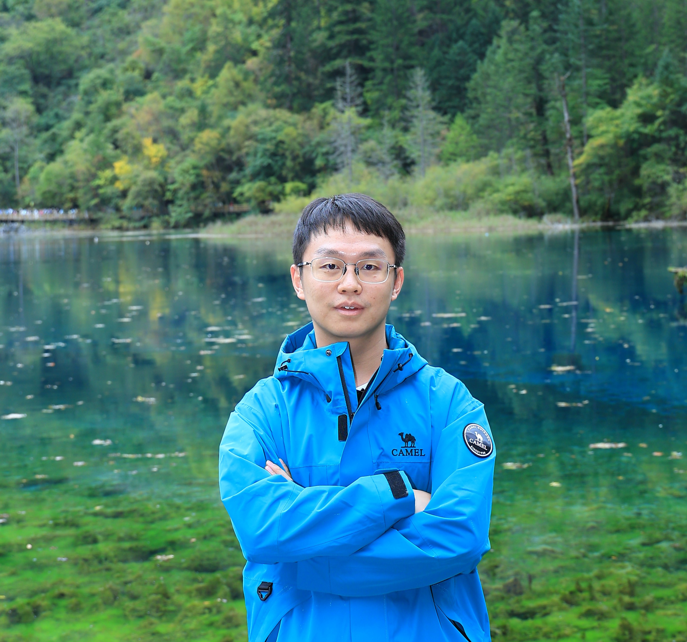
</section>
<section class="tech-scene" aria-label="Closed loop: 4D Sandbox to Perception to Action and back to the sandbox">
4D SANDBOX → PERCEPTION → ACTION<button id="motion-toggle" type="button" aria-pressed="false">Pause animation</button>
<svg id="research-loop" xmlns="http://www.w3.org/2000/svg" viewBox="0 0 920 290" role="img" aria-label="4D Sandbox connects to Perception, then Action. Observations and state feed back from Action into the 4D Sandbox."></svg><noscript>
4D Sandbox → Perception → Action → Feedback to the Sandbox
</noscript></section>
<section id="research">
<h2>Publications & Projects</h2>2021–2026

<article class="paper"><a class="paper-visual" href="https://doi.org/10.1109/TVCG.2026.3656737" target="_blank" rel="noopener">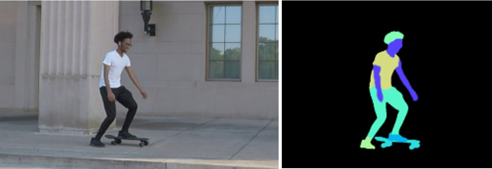</a>
<h3><a href="https://doi.org/10.1109/TVCG.2026.3656737" target="_blank" rel="noopener">Hie4DGS: Hierarchical 4D Gaussian Splatting From Monocular Dynamic Video</a></h3>
<strong>Kai Cheng</strong>, Kaizhi Yang, Xiaoxiao Long, Xiaoyang Guo, Xuejin Chen

IEEE Transactions on Visualization and Computer Graphics (TVCG), 2026
<a class="paper-link" href="https://doi.org/10.1109/TVCG.2026.3656737" target="_blank" rel="noopener">Paper / Project ↗</a>
</article>
<article class="paper"><a class="paper-visual" href="https://github.com/xhd0612/GaussianRoom" target="_blank" rel="noopener">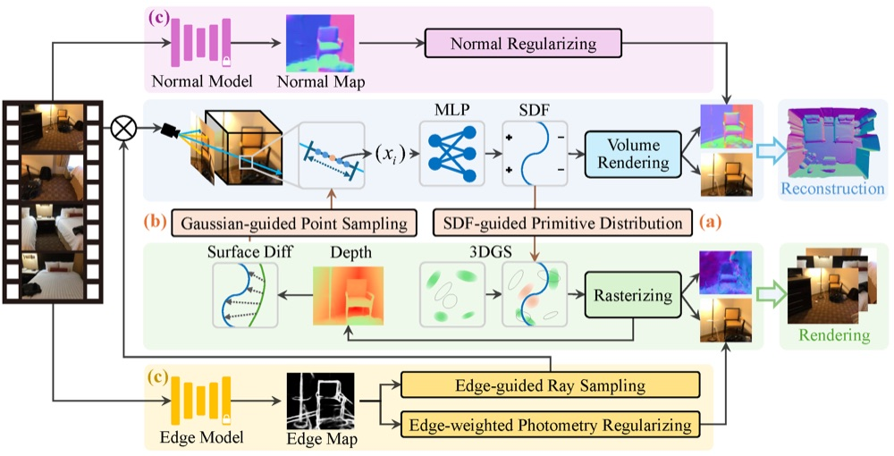</a>
<h3><a href="https://github.com/xhd0612/GaussianRoom" target="_blank" rel="noopener">GaussianRoom: Improving 3D Gaussian Splatting with SDF Guidance and Monocular Cues for Indoor Scene Reconstruction</a></h3>
Haodong Xiang*, Xinghui Li*, <strong>Kai Cheng*</strong>, Xiansong Lai, Wanting Zhang, Zhichao Liao, Long Zeng, Xueping Liu

ICRA 2025

* Equal contribution (co-first author)
<a class="paper-link" href="https://github.com/xhd0612/GaussianRoom" target="_blank" rel="noopener">Paper / Project ↗</a>
</article>
<article class="paper"><a class="paper-visual" href="https://linhanwang.github.io/dcgaussian/" target="_blank" rel="noopener">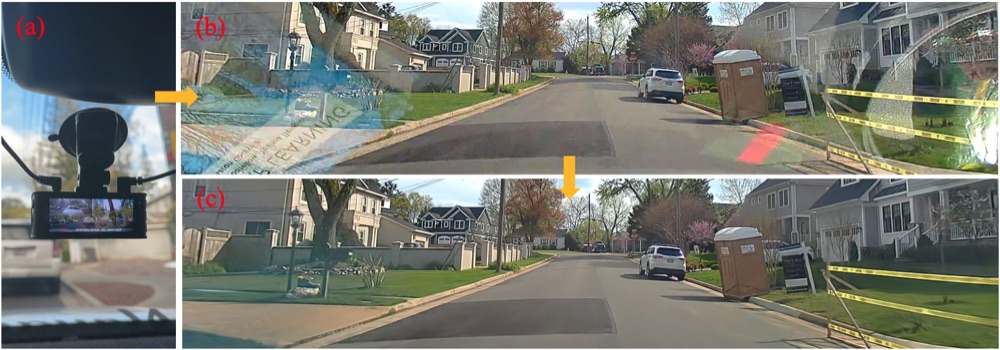</a>
<h3><a href="https://linhanwang.github.io/dcgaussian/" target="_blank" rel="noopener">DC-Gaussian: Improving 3D Gaussian Splatting for Reflective Dash Cam Videos</a></h3>
Linhan Wang*, <strong>Kai Cheng*</strong>, Shuo Lei, Shengkun Wang, Wei Yin, Chenyang Lei, Xiaoxiao Long, Chang-Tien Lu

NeurIPS 2024

* Equal contribution (co-first author)
<a class="paper-link" href="https://linhanwang.github.io/dcgaussian/" target="_blank" rel="noopener">Paper / Project ↗</a>
</article>
<article class="paper"><a class="paper-visual" href="https://kcheng1021.github.io/gaussianpro.github.io/" target="_blank" rel="noopener">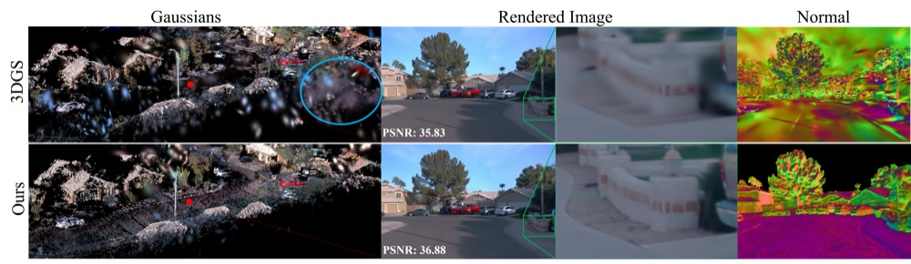</a>
<h3><a href="https://kcheng1021.github.io/gaussianpro.github.io/" target="_blank" rel="noopener">GaussianPro: 3D Gaussian Splatting with Progressive Propagation</a></h3>
<strong>Kai Cheng</strong>, Xiaoxiao Long, Kaizhi Yang, Yao Yao, Wei Yin, Yuexin Ma, Wenping Wang, Xuejin Chen

ICML 2024
<a class="paper-link" href="https://kcheng1021.github.io/gaussianpro.github.io/" target="_blank" rel="noopener">Paper / Project ↗</a>
</article>
<article class="paper"><a class="paper-visual" href="https://kcheng1021.github.io/ucnerf.github.io/" target="_blank" rel="noopener">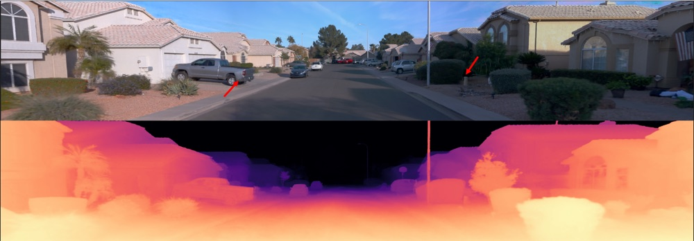</a>
<h3><a href="https://kcheng1021.github.io/ucnerf.github.io/" target="_blank" rel="noopener">UC-NeRF: Neural Radiance Field for Under-Calibrated Multi-view Cameras in Autonomous Driving</a></h3>
<strong>Kai Cheng</strong>, Xiaoxiao Long, Wei Yin, Jin Wang, Zhiqiang Wu, Yuexin Ma, Kaixuan Wang, Xiaozhi Chen, Xuejin Chen

ICLR 2024
<a class="paper-link" href="https://kcheng1021.github.io/ucnerf.github.io/" target="_blank" rel="noopener">Paper / Project ↗</a>
</article>
<article class="paper"><a class="paper-visual" href="https://aim-uofa.github.io/FrozenRecon/" target="_blank" rel="noopener">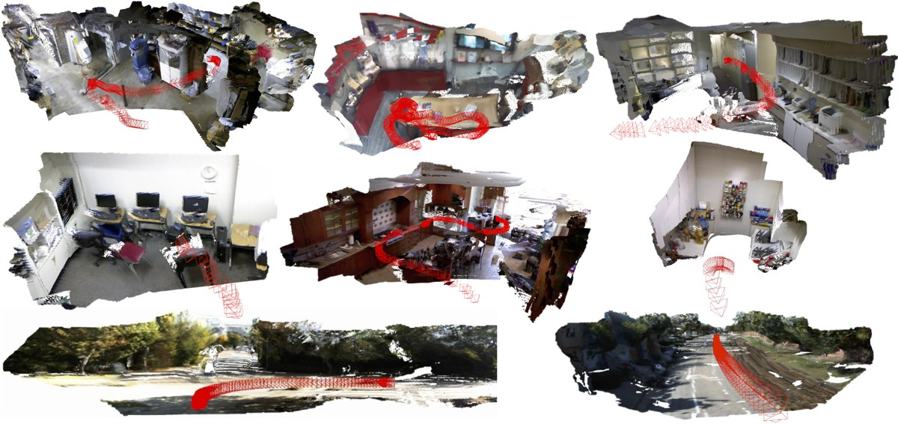</a>
<h3><a href="https://aim-uofa.github.io/FrozenRecon/" target="_blank" rel="noopener">FrozenRecon: Pose-free 3D Scene Reconstruction with Frozen Depth Models</a></h3>
Guangkai Xu, Wei Yin, Hao Chen, Chunhua Shen, <strong>Kai Cheng</strong>, Feng Zhao

ICCV 2023
<a class="paper-link" href="https://aim-uofa.github.io/FrozenRecon/" target="_blank" rel="noopener">Paper / Project ↗</a>
</article>
<article class="paper"><a class="paper-visual" href="https://arxiv.org/abs/2304.07051" target="_blank" rel="noopener">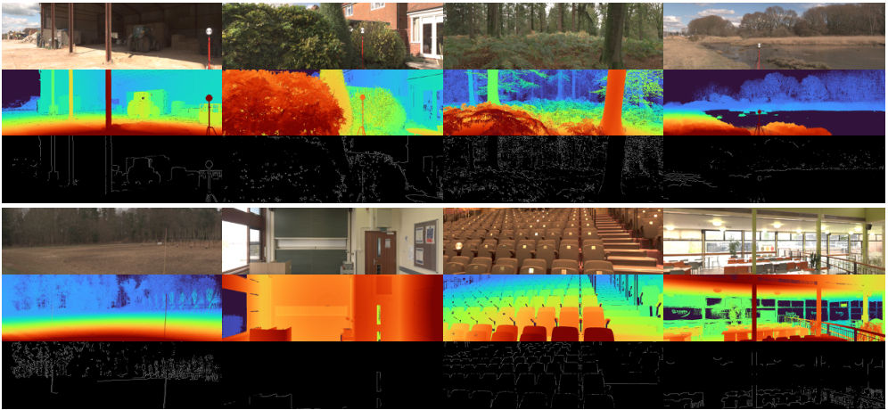</a>
<h3><a href="https://arxiv.org/abs/2304.07051" target="_blank" rel="noopener">The Second Monocular depth estimation Challenge</a></h3>
Our team won the CVPR 2023 Monocular Depth Estimation Challenge. I served as the first student team member and also contributed the SLAM experiment to <a href="https://arxiv.org/abs/2307.10984">Metric3D (ICCV 2023)</a>.

CVPR Challenge 2023
<a class="paper-link" href="https://arxiv.org/abs/2304.07051" target="_blank" rel="noopener">Paper / Project ↗</a>
</article>
<article class="paper"><a class="paper-visual" href="https://arxiv.org/abs/2205.02481" target="_blank" rel="noopener">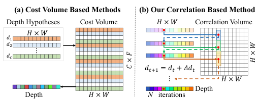</a>
<h3><a href="https://arxiv.org/abs/2205.02481" target="_blank" rel="noopener">Exploiting Correspondences with All-pairs Correlations for Multi-view Depth Estimation</a></h3>
<strong>Kai Cheng</strong>, Hao Chen, Wei Yin, Guangkai Xu, Xuejin Chen

arXiv 2022
<a class="paper-link" href="https://arxiv.org/abs/2205.02481" target="_blank" rel="noopener">Paper / Project ↗</a>
</article>
<article class="paper"><a class="paper-visual" href="https://arxiv.org/abs/2202.01470v2" target="_blank" rel="noopener">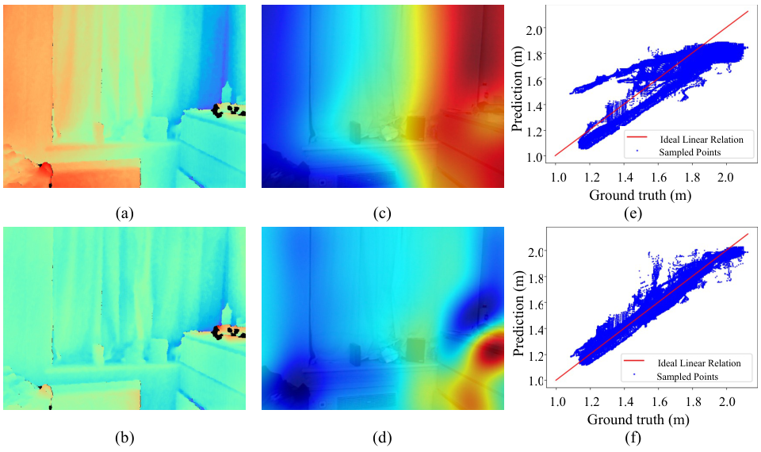</a>
<h3><a href="https://arxiv.org/abs/2202.01470v2" target="_blank" rel="noopener">Towards 3D Scene Reconstruction from Locally Scale-Aligned Monocular Video Depth</a></h3>
Guangkai Xu, Wei Yin, Hao Chen, <strong>Kai Cheng</strong>, Feng Zhao, Chunhua Shen

arXiv 2022
<a class="paper-link" href="https://arxiv.org/abs/2202.01470v2" target="_blank" rel="noopener">Paper / Project ↗</a>
</article>
<article class="paper"><a class="paper-visual" href="https://link.springer.com/chapter/10.1007/978-3-030-87231-1_12" target="_blank" rel="noopener">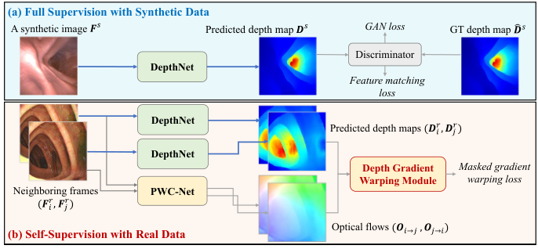</a>
<h3><a href="https://link.springer.com/chapter/10.1007/978-3-030-87231-1_12" target="_blank" rel="noopener">Depth Estimation for Colonoscopy Images with Self-supervised Learning from Videos</a></h3>
<strong>Kai Cheng</strong>, Yiting Ma, Bin Sun, Yang Li, Xuejin Chen

MICCAI 2021 · Early accept (top 13%)
<a class="paper-link" href="https://link.springer.com/chapter/10.1007/978-3-030-87231-1_12" target="_blank" rel="noopener">Paper / Project ↗</a>
</article>
<article class="paper"><a class="paper-visual" href="https://link.springer.com/chapter/10.1007/978-3-030-87240-3_37" target="_blank" rel="noopener">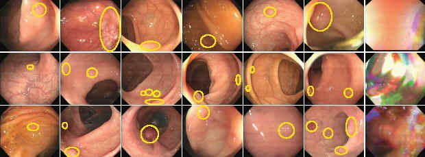</a>
<h3><a href="https://link.springer.com/chapter/10.1007/978-3-030-87240-3_37" target="_blank" rel="noopener">LDPolypVideo Benchmark: A Large-Scale Colonoscopy Video Dataset of Diverse Polyps</a></h3>
Yiting Ma, Xuejin Chen, <strong>Kai Cheng</strong>, Yang Li, Bin Sun

MICCAI 2021
<a class="paper-link" href="https://link.springer.com/chapter/10.1007/978-3-030-87240-3_37" target="_blank" rel="noopener">Paper / Project ↗</a>
</article>
</section>
<section id="experience"><h2>Experience</h2>
2022.12 – 2023.11
<strong>DJI Technology</strong> · Research Intern

2021.03 – 2022.01
<strong>Huawei Noah's Ark Lab</strong> · Research Intern

2019.10 – 2020.01
<strong>Megvii, Nanjing</strong> · Research Intern

</section>

<section><h2>Awards</h2>
Master's First Class Scholarship · 2020, 2021

National Scholarship · 2017
</section><section><h2>Teaching</h2>
Teaching Assistant, Image Understanding

2023, 2024
</section>
<section id="visitors" class="visitors">
<h2>Visitors around the world</h2>Global connections

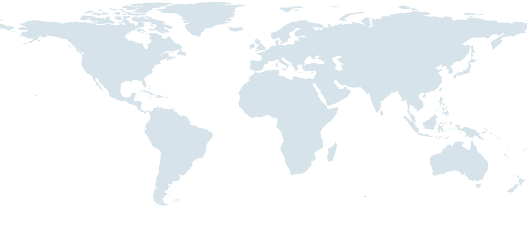

Loading visitor map…
<noscript>
Enable JavaScript to view the visitor map.
</noscript>
</section><footer>Kai Cheng<a href="#about">Back to top ↑</a></footer></main></body></html>